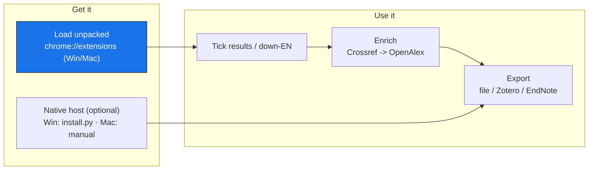

# AliAwaisKhalid/scholar-to-endnote
Select Google Scholar results (search, profile, cited-by, library), enrich via Crossref/OpenAlex, show journal-quality badges, export to EndNote/Zotero (RIS/ENW/BibTeX/RefWorks), and convert PDFs to Markdown.
Manual: this file · GitHub: https://github.com/AliAwaisKhalid/scholar-to-endnote
Reference: README.md
Needs: Chrome or any Chromium browser (Windows or macOS). Python 3 on PATH only for the optional native host.

## Before you start
- Is scholar-to-endnote free? Yes. MIT licensed (see LICENSE).
- Is scholar-to-endnote still maintained? Private-origin, single-author project. Latest: v0.3.0.
- How widely used is scholar-to-endnote? New, little track record. Unpacked/dev use; no Chrome Web Store listing yet (no icons).
- No build step, no npm, nothing to compile. You load the folder into Chrome as-is.

---

## 1. Install the extension (Chrome — Windows & macOS, identical)
1. Get the code:
```
git clone https://github.com/AliAwaisKhalid/scholar-to-endnote.git
cd scholar-to-endnote
```
2. Open `chrome://extensions` in Chrome (works the same on Windows and macOS).
3. Turn **Developer mode** ON (top-right toggle).
4. Click **Load unpacked** and pick the `scholar-to-endnote` folder.
   - **Windows:** e.g. `C:\Users\<you>\...\scholar-to-endnote`
   - **macOS:** e.g. `/Users/<you>/.../scholar-to-endnote`
5. Open a Scholar search: `https://scholar.google.com/scholar?q=...`
   (search first — the bare homepage is not matched).
6. Verify: a blue bar appears **bottom-right** (`cart · format · target · Export cart · Clear`),
   and every result row gets a checkbox + `↓EN` + `★` (plus `↓MD` on `[PDF]` results).

After editing any file: click the extension's **reload ⟳** on `chrome://extensions`, then refresh the Scholar tab.

This alone gives you: cart, enrichment, journal-quality `★`, and export via **Download file** or **Zotero** (Zotero running). No Python needed.

---

## 2. Optional native host — EndNote auto-import + `↓MD` PDF→Markdown

### Windows (scripted)
```
python nativehost\install.py
pip install markitdown
```
`install.py` auto-detects the extension ID from Chrome and registers the host in
HKCU. If detection fails, pass the ID from `chrome://extensions`:
```
python nativehost\install.py <EXTENSION_ID>
```
Restart Chrome. For EndNote auto-import, associate `.ris` files with EndNote.

### macOS (manual — not yet scripted)
`install.py` is Windows-only (registry + `.bat`). On macOS set it up by hand:
```
pip3 install markitdown
# 1. make the host runnable
chmod +x nativehost/endnote_host.py
# 2. create the host manifest for Chrome (replace <EXTENSION_ID> and the abs path)
mkdir -p ~/Library/Application\ Support/Google/Chrome/NativeMessagingHosts
cat > ~/Library/Application\ Support/Google/Chrome/NativeMessagingHosts/com.endnote_import.host.json <<JSON
{
  "name": "com.endnote_import.host",
  "description": "Scholar to EndNote import host",
  "path": "/ABSOLUTE/PATH/TO/scholar-to-endnote/nativehost/endnote_host.py",
  "type": "stdio",
  "allowed_origins": ["chrome-extension://<EXTENSION_ID>/"]
}
JSON
```
The `path` must point at `endnote_host.py` and that file needs a `#!/usr/bin/env python3`
shebang (or wrap it in a shell script that calls `python3`). Restart Chrome.
Without the host, the **Download file** target works everywhere and the EndNote
target falls back to a `.ris` download.

---

## How it fits together


Full reference (badges, bundled rankings, known limits): [README.md](README.md).
License: MIT. Read commands before running them.
