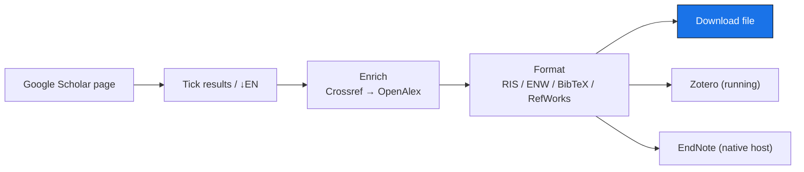

# Setup: Scholar → EndNote Export (Windows)

Chrome MV3 extension. Pick Google Scholar results → enrich (Crossref/OpenAlex) →
export RIS/ENW/BibTeX/RefWorks to a file, Zotero, or EndNote. Optional native
host adds EndNote auto-import and PDF→Markdown.

## Before you start
- **Chrome** (or any Chromium browser with `chrome://extensions`).
- **Python on PATH** — only if you want the native host (EndNote auto-import, ↓MD).
  Check: `python --version`. Yours lives at `C:\Python313\python.exe`.
- No build step. No npm. Nothing to compile.

## Core install (required) — load unpacked
1. Open `chrome://extensions`.
2. Toggle **Developer mode** (top-right) **on**.
3. Click **Load unpacked** → select this folder:
   `C:\Users\aliaw\Downloads\scholar-endnote-extension`
4. Run a search at `https://scholar.google.com/scholar?q=...` (the bare homepage
   is not matched — search first).
5. Confirm it works: a blue bar appears **bottom-right**
   (`cart: 0 · format · target · Export cart · Clear`), and each result row gets
   a checkbox + `↓EN` + `★` (+ `↓MD` on `[PDF]` results).

After editing any extension file: click the extension's **reload ⟳** on
`chrome://extensions`, then **refresh** the Scholar tab.

## Native host (optional) — EndNote auto-import + ↓MD
Enables the **EndNote (auto-import)** target and the `↓MD` PDF→Markdown button.
Without it, the **Download file** target still works and EndNote falls back to a
`.ris` download.

```powershell
python nativehost\install.py
pip install markitdown
```

`install.py` auto-detects the extension ID from Chrome. If detection fails, pass
it explicitly (copy the ID from `chrome://extensions`):

```powershell
python nativehost\install.py <EXTENSION_ID>
```

Then **restart Chrome**. For EndNote auto-import, `.ris` must be file-associated
with EndNote (the host writes a temp `.ris` and opens it).

## How it fits together


Full reference, journal-quality badges, bundled rankings, and known limits:
see [README.md](README.md).
