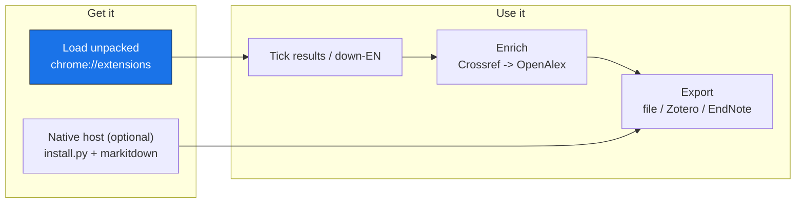

# AliAwaisKhalid/scholar-to-endnote
Select Google Scholar results (search, profile, cited-by, library), enrich via Crossref/OpenAlex, show journal-quality badges, export to EndNote/Zotero (RIS/ENW/BibTeX/RefWorks), and convert PDFs to Markdown.
Manual: this file · GitHub: https://github.com/AliAwaisKhalid/scholar-to-endnote
Reference: README.md
Needs: Chrome (Chromium). Python on PATH only for the optional native host.

## Before you start
- Is scholar-to-endnote free? Yes. Source-available (no LICENSE file yet — add one before sharing).
- Is scholar-to-endnote still maintained? Private, single-author project. Latest: v0.3.0.
- How widely used is scholar-to-endnote? Not public, no track record. It's your own repo — unpacked/dev use only, no Chrome Web Store listing (no icons yet).

## Windows: Yes, it installs on your Windows (yes)
- No ready-made download / no build step. It installs as an unpacked Chrome extension.
Install (core, required): load this folder via `chrome://extensions` → Developer mode → Load unpacked.
Install (native host, optional — EndNote auto-import + ↓MD): `python nativehost\install.py`
Install (PDF→Markdown dep, optional): `pip install markitdown`
Steps from source:
1. Check it supports your device (Chrome/Chromium with `chrome://extensions`; Python only for the host).
2. Clone the repository (Needs Git: winget install Git.Git)
```
git clone https://github.com/AliAwaisKhalid/scholar-to-endnote.git
cd scholar-to-endnote
```
3. Load the extension (no runtime to install)
```
# chrome://extensions  ->  Developer mode ON  ->  Load unpacked  ->  pick this folder
```
4. (Optional) Install the native host for EndNote auto-import and PDF->Markdown
```
python nativehost\install.py
pip install markitdown
```
(auto-detects the extension ID; pass it explicitly if detection fails:
`python nativehost\install.py <EXTENSION_ID>`). Restart Chrome.
5. Run it
```
# Open  https://scholar.google.com/scholar?q=...  (search first; the bare homepage is not matched)
# Blue bar appears bottom-right; each result row gets checkbox + down-EN + star (+ down-MD on [PDF]).
```
6. After editing files: reload the extension on chrome://extensions, then refresh the Scholar tab.
How it fits together:


Generated locally by Claude from the repo's own files (not analyzed by gitmanual — this is a private repo). Read commands before running them.
